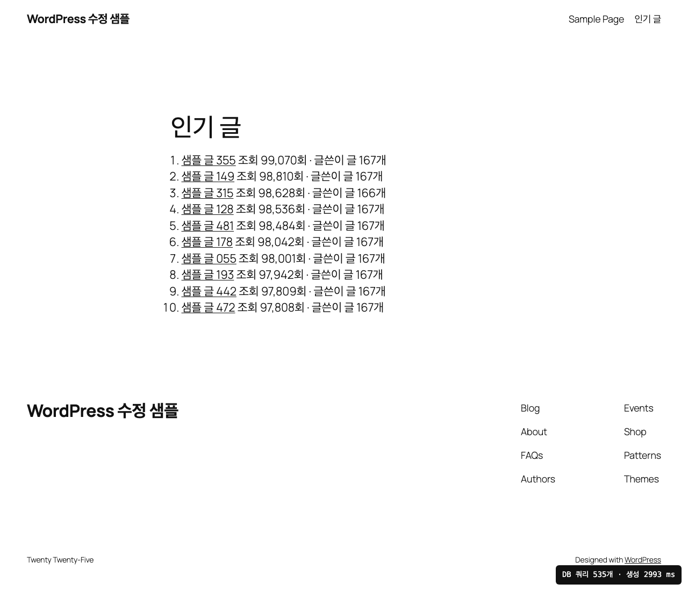

# wordpress-slow-list-fix

> 샘플 프로젝트입니다. 워드프레스 목록이 글마다 데이터베이스를 읽는 경우를 한 쿼리로 줄인 예제이며, 고객 작업물이 아닙니다.

글 500개의 인기 글 10개를 보여 주는 플러그인입니다. 주소에 `?ppl=before`를 붙이면 수정 전이고, 기본 주소는 수정 후입니다. 두 주소의 글 목록은 같습니다.

## 실측 (2026-11-14)

로컬 WordPress Playground(PHP 8.3, SQLite), 글 500개, 요청 5회.

| 주소 | DB 쿼리 수 | PHP 생성 시간 |
|---|---|---|
| `/?ppl=before` | 5회 모두 535 | 951~3,577 ms |
| `/` | 5회 모두 32 | 573~1,374 ms |

쿼리 수는 두 번의 5회 측정에서 같았다. PHP 생성 시간은 서버를 한 번 쓴 뒤의 실행에서 더 짧았다. 인기 글 10개의 제목과 조회수는 수정 전과 수정 후가 같았다. 화면의 쿼리 표시는 페이지 하단 `DB 쿼리 N개`와 HTML 주석 `query-meter`입니다. 수정 후 32개에는 워드프레스 기본 쿼리와 고유주소 조회가 포함됩니다. 플러그인이 목록을 위해 직접 보내는 쿼리는 상위 글 1개와 글쓴이별 글 수 1개입니다.



수정 전 화면은 쿼리 535개입니다. 수정 후 화면은 같은 목록이고 쿼리 32개입니다. 수정 후 화면은 2026-11-14에 브라우저로 확인했습니다.

## 실행

Node.js 20 이상이 필요합니다. Docker와 PHP 설치는 필요 없습니다.

```bash
git clone https://github.com/ddadasoft/wordpress-slow-list-fix
cd wordpress-slow-list-fix
bash scripts/start.sh
```

다른 터미널에서 확인합니다.

```bash
bash scripts/compare.sh
```

서버는 `http://127.0.0.1:9400/` 입니다. 포트를 바꾸려면 `PORT=9401 bash scripts/start.sh` 와 `PORT=9401 bash scripts/compare.sh`를 씁니다.

## 구성

| 경로 | 하는 일 |
|---|---|
| `plugins/popular-posts-list/popular-posts-list.php` | 수정 전과 수정 후. 기본은 수정 후 |
| `mu-plugins/query-meter.php` | 이번 요청의 DB 쿼리 수와 PHP 생성 시간 |
| `setup/seed.php` | 글쓴이 3명, 글 500개, 첫 화면 |
| `scripts/start.sh` | Playground 서버 |
| `scripts/compare.sh` | 쿼리 수와 목록 비교. 목록이 다르거나 쿼리가 줄지 않으면 종료 코드 1 |
